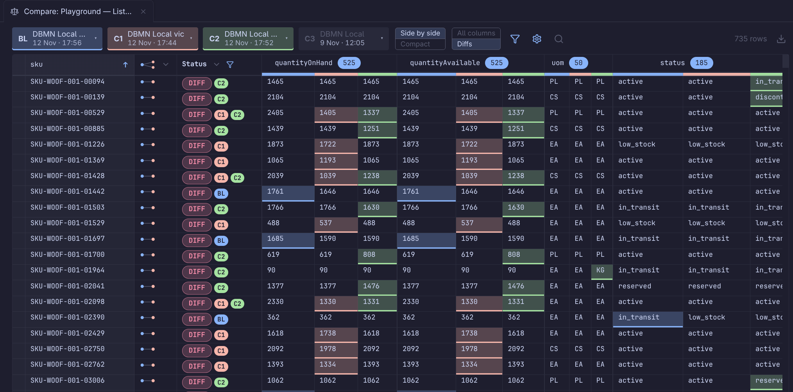
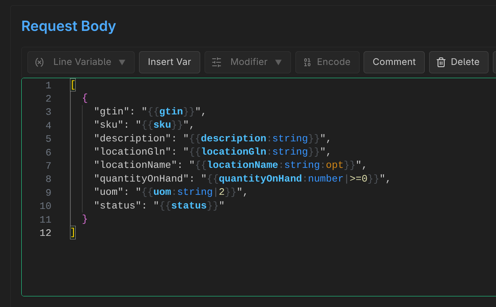

<h3>Your database for REST APIs. Data in. Data out. D*MN fast.</h3>

Free and open source · [Website](https://dbmn.io) · [Docs](https://dbmn.io/docs/) · [Web app](https://app.dbmn.io) · [Report an issue](https://github.com/dbmn-io/dobermann/issues)

## Data in

Load records, create test data, or fix thousands at once, through any REST API. Pull records out, fix them in Excel, push them back.

1. **Template**: the request body in JSON, with type-safe variables (more below).
2. **Map**: a CSV or Excel file to the template. Array detection puts many rows in one request. Preview before you commit.
3. **Load**: hit go. Up to 16 requests in parallel, every row tracked.
4. **Error handling**: see and fix errors in real time.

## Data out

1. **Extract**: every page, fetched in parallel. It lands as a table you can view your way, with the JSON a click away when you need it.
2. **Shape**: search, sort, pick your columns and save the view.
3. **Chain**: send one run's results straight into another API's batch.
4. **Compare**: line results up on a key, DEV against PROD or today against last week.

## Type-safe templates

Write the request once. Every `{{variable}}` knows its type and its rules, so a bad row is caught before anything is sent.

The body is an array, so one request carries many rows. 67,000 rows at 100 per request is 670 requests, not 67,000. Run 16 at a time and a 12-hour load takes under ten minutes.

[All the template options](https://dbmn.io/docs/template-variables/)

## Your data, your call

- **No account needed**: everything works in VS Code signed out, with no limits.
- **On your machine**: requests go straight from your computer to your API, and the results stay there.
- **Secrets stay local**: tokens and keys never leave your machine, even with sync on.
- **Safe on production**: a production environment turns the header red and asks before a run.
- **Sync if you want it**: sign in to keep your endpoints and environments on every computer and in the [web app](https://app.dbmn.io).
- **Minimal telemetry**: daily counts only, and only while signed in. Never an address, a path or your data. See [TELEMETRY.md](https://github.com/dbmn-io/dobermann/blob/HEAD/TELEMETRY.md).

## Getting started

Two ways in, both free:

- **In your browser**: open **[app.dbmn.io](https://app.dbmn.io)** and sign in with a free account. Nothing to install.
- **In VS Code**: **[install the extension](https://marketplace.visualstudio.com/items?itemName=dbmn.dobermann)** (or search for *Dobermann* in the Extensions view), then click the Dobermann icon in the Activity Bar. No account needed.

New to it? **[Puppy School](https://dbmn.io/puppy-school/)** teaches you Dobermann in five in-depth lessons. Full documentation is at **[dbmn.io/docs](https://dbmn.io/docs/)**.

## Open source

The source code is on [GitHub](https://github.com/dbmn-io/dobermann). To build it yourself, see
[CONTRIBUTING.md](https://github.com/dbmn-io/dobermann/blob/HEAD/CONTRIBUTING.md).

GNU Affero General Public License v3.0, see [LICENSE](https://github.com/dbmn-io/dobermann/blob/HEAD/LICENSE). Copyright (C) 2026 Flexion
Tech Pty Ltd. *DBMN* and *Dobermann* are trademarks of Flexion Tech Pty Ltd: see
[TRADEMARKS.md](https://github.com/dbmn-io/dobermann/blob/HEAD/TRADEMARKS.md).

Contributions are welcome. Open an issue first so we can talk it through. Before we merge
your first pull request, we'll ask you to sign our [Contributor License Agreement](https://github.com/dbmn-io/dobermann/blob/HEAD/CLA.md).
